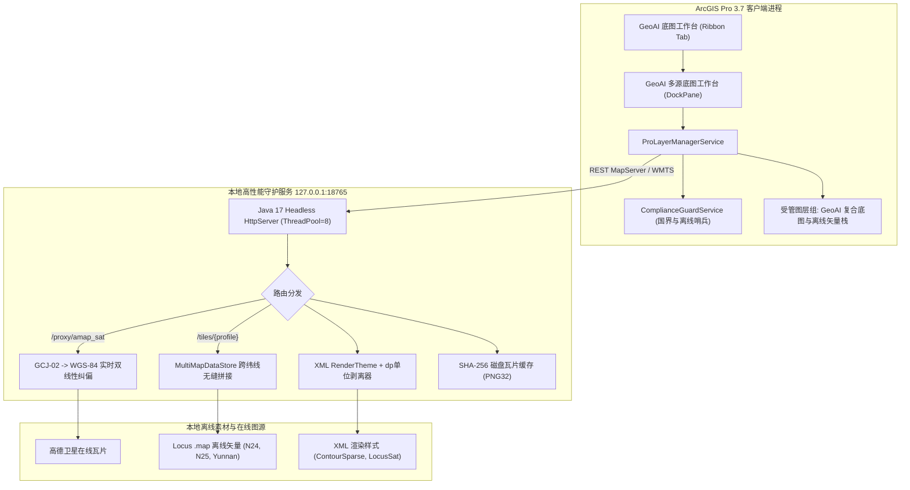

# ArcGIS Pro Mapsforge & Multi-Source Basemap Add-In
### (ArcGIS Pro 3.7 多源合规底图与 Mapsforge 离线矢量拆层底图工作台)

[](https://www.esri.com/en-us/arcgis/products/arcgis-pro/overview)
[](https://dotnet.microsoft.com/)
[](https://www.oracle.com/java/)
[](https://github.com/mapsforge/mapsforge)
[](https://github.com/Gmatrix2022/arcgis-pro-basemap-addin)
[](https://gitee.com/nousyang/arcgis-pro-basemap-addin)
[](LICENSE)

> **ArcGIS Pro 3.7 现代化全功能底图扩展插件**：基于 Pro SDK 3.7 (.NET 10) 与高性能 Mapsforge 0.25.0 (Java 17) 无头渲染微服务，实现 **GCJ-02 在线卫图实时双线性纠偏至 WGS-84**、**本地 `.map` 离线矢量瓦片三层拆层渲染**（纯等高线透明层 + 户外路网注记层 + 卫星底图）以及**国界触发强制合规拦截**。

---

## 📸 实机运行效果 (Live Screenshot)


*图 1：在 ArcGIS Pro 3.7 中一键加载昆明-滇池黄金三层复合栈（底层高德卫星实时纠偏 WGS-84 + 中层 N24/N25 跨纬线 50m 等高线透明层 + 顶层 LocusSat 路网与地名注记）*

---

## ✨ 核心特性 (Key Features)

### 1. 黄金三层拆层架构 (Three-Layer Composite Stack)
- **底层（卫星底图）**：高德卫星影像（`amap_sat`）通过本地代理，采用双线性插值实时从 **GCJ-02 坐标系逆投影至 WGS-84**，与真实 GPX 轨迹及国际地理数据零偏移叠合。
- **中层（地形等高线）**：基于本地 `N24E102.map` 与 `N25E102.map`，通过 `MultiMapDataStore(RETURN_ALL)` 实现 **25.0°N 跨纬线无缝拼接**，以 PNG32 纯透明背景渲染 50m 稀疏等高线。
- **顶层（路网与地名注记）**：基于 `Ch-Yunnan_oam.osm.map` 渲染高速、主干道、步道及山峰（西山、碧鸡关等）地名注记，自动剥离遮挡卫图的保护区绿色斜纹（`hatch`）。

### 2. 双协议高性能无头渲染引擎 (MapsforgeTileServer)
- 原生暴露 **ArcGIS REST MapServer** (`/arcgis/rest/services/{profileId}/MapServer`) 与 **OGC WMTS 1.0.0** (`/wmts/...`)，ArcGIS Pro 原生秒级直连。
- 支持 Mapsforge V4/V5 主题，内置 **`dp` 单位正则动态剥离**（兼容 Locus Map 等移动端主题）。
- 基于 `(mapFiles, themeSpec, excludeCats, transparent, tileSize)` 计算 **SHA-256 CacheKey**，实现毫秒级磁盘缓存命中（`X-Tile-Cache: HIT`）。

### 3. 合规性与离线断网哨兵 (Compliance & Offline Guard)
- **纯离线断网竞赛模式**：一键阻断所有外部 HTTP 请求，仅从本地 `.map` 文件与离线缓存出图。
- **国界触发拦截制（Border-Trigger）**：严格遵循测绘地理信息合规规范。当视野包含未审核中国国界时，自动熔断未经审图号的境外图源（OSM/OpenTopoMap），保全地理合规底线。

---

## 🏛️ 系统架构 (Architecture)



---

## 🚀 快速上手 (Quick Start)

### 编译与安装前提 (Prerequisites)
1. **操作系统**：Windows 10 / 11 (x64)
2. **宿主软件**：ArcGIS Pro 3.4 / 3.5 / 3.6 / 3.7
3. **运行时与 SDK**：
   - [.NET 10 SDK (Windows Desktop)](https://dotnet.microsoft.com/download/dotnet/10.0)
   - [ArcGIS Pro SDK for .NET 3.7](https://pro.arcgis.com/en/pro-app/latest/sdk/)
   - Java 17+ (JDK / JRE)

### 一键构建 (Build)

1. **构建 Mapsforge 渲染服务端**：
```powershell
powershell -ExecutionPolicy Bypass -File src/MapsforgeTileServer/build.ps1
```

2. **编译并自动注册 ArcGIS Pro Add-In**：
```powershell
dotnet build src/ArcGISProBasemapAddin/ArcGISProBasemapAddin.csproj -c Release
```
> 编译成功后，`RegisterAddIn.exe` 会自动将 `.esriAddinX` 注册至当前系统的 ArcGIS Pro 安装路径。

3. **启动 ArcGIS Pro**：
打开任何 `.aprx` 工程，顶部工具栏即可看到 **`GeoAI 底图工作台`** 标签页，点击 `多源底图工作台` 即可呼出交互式面板。

---

## 🧪 自动化测试套件 (Verification Suite)

项目内建端到端自动化检验测试：
```powershell
python tests/verify_stage0_and_e2e.py
```
**测试门禁（6大门禁全部通过）：**
- **G1 (Probe)**：`.map` 文件头与瓦片特征抽样自动识别分类。
- **G2 (Alpha)**：PNG32 纯透明通道测试（透明像素比率 91.8%）。
- **G3 (Stitch)**：`N24E102` + `N25E102` 在 25.0°N 跨纬线多要素无缝拼接。
- **G4 (Theme & Unit)**：`dp` 单位正则剥离与 CacheKey 隔离切换。
- **G5 (GCJ02-WGS84)**：高德卫星切片双线性插值实时纠偏与 GPX 轨迹零偏移。
- **G6 (Compliance)**：国界触发与离线断网硬防护拦截。

---

## 📄 开源许可证 (License)

本项目采用 [Apache License 2.0](LICENSE) 开源协议。
欢迎提交 Issue 与 Pull Request 共同改进！
