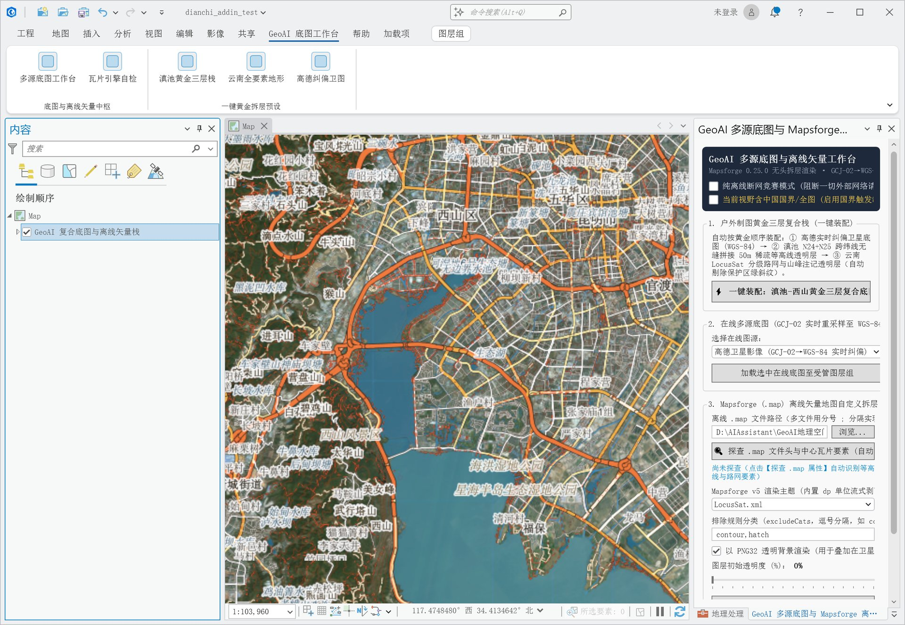
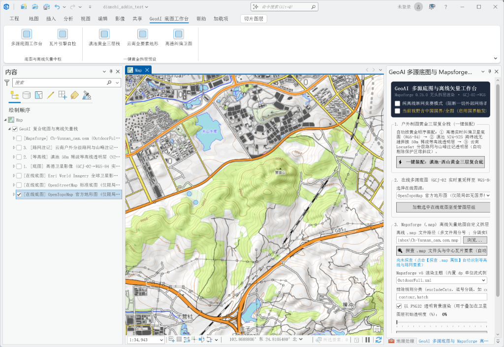

# 告别坐标漂移与离线孤岛：我为 ArcGIS Pro 3.7 写了个多源合规底图与 Mapsforge 矢量插件（附开源）

如果你是一名 GIS 工程师、赛事赛道设计师、户外测绘工作者，或者热衷于轨迹规划的户外运动爱好者，在打开 **ArcGIS Pro** 准备大展身手时，大概率遭遇过这两座让人抓狂的“大山”：

1. **“火星坐标”漂移噩梦**：手头拿着精准的户外手表/GPS 记录的 WGS-84 轨迹，或者无人机航测点云，想叠加上国内的高德高清卫星图看看地物。结果屏幕一亮——整条轨迹硬生生向东南方向**漂移了 300 到 500 米**！轨迹直接冲进滇池水里、或者挂在悬崖峭壁之外；
2. **移动端离线格式的“格式孤岛”**：在手机端户外神器 **Locus Map**、**两步路**、**OruxMaps** 里，几十兆的 Mapsforge 离线矢量文件（`.map`）搭配高程渲染主题（Elevate / LocusSat），就能丝滑呈现全国等高线与野径。然而，一回到几十个 G 的专业桌面 GIS（ArcGIS Pro）里，居然**找不到任何原生接口去直接打开和渲染 `.map` 离线矢量**！

为了彻底铲平这个痛点，我基于 **ArcGIS Pro 3.7 SDK (.NET 10)** 和 **Mapsforge 0.25.0 (Java 17)**，自主设计并开源了一款轻量、专业且合规的底图插件：**`ArcGISProBasemapAddin`**。

今天，把这个项目的完整设计理念、技术架构与开源成果分享给大家。

---

## 一、核心痛点与破局之道

在传统的制图工作流中，想要在 ArcGIS Pro 里拼出一张“高清卫星图 + 50米等高线 + 清晰地名注记”的专业户外底图，过程极其繁琐：

* **纠偏困境**：要么花大量时间用 GDAL 脚本或离线纠偏工具做切片重投影，耗时耗硬盘；要么直接放弃国内高分辨率卫星源，忍受 Esri/Bing 偏远山区低清晰度的底图；
* **等高线“糊成一团”**：网上找的公开瓦片往往把卫星底图和等高线死死焊在一张 JPEG 里，无法分别调透明度，山体阴影和暗色植被在等高线密集处黑糊糊一片，严重影响视觉判读；
* **北纬 25 度接缝断裂**：50 米高精 SRTM 等高线切片通常以整经纬度（如 `N24E102`、`N25E102`）分块，很多渲染器在跨纬线时（例如昆明主城恰好处在北纬 25° 线上）发生等高线硬生生截断；
* **边境合规与断网野外**：在边境或涉密区域，直接拉取未经审图号的境外切片源存在严重合规隐患；而在无信号的野外应急现场，没有离线渲染能力直接寸步难行。

---

## 二、独创“黄金三层拆层”工作台

针对上述问题，本插件在 ArcGIS Pro 3.7 中开创性地实现了**“黄金三层独立拆层”**渲染流水线：


*图 1：ArcGIS Pro 3.7 实机运行效果——高德纠偏卫星底图 + 跨纬度 50m SRTM 等高线 + 户外地名注记黄金三层栈，严丝合缝对齐 WGS-84 坐标系*

### 1. 底层：GCJ-02 动态逆采样纠偏卫星层（WGS-84 对齐）
插件内置极速本地逆采样反解代理，在请求高德高清卫星瓦片时，实时进行高精度双线性内插坐标变换。
* **效果**：将原本存在 300~500 米非线性偏移的火星坐标，在毫秒级内校正至精准的 WGS-84 / CGCS2000 坐标系；
* 无论是叠加手持 GPS 导出的 GPX 轨迹，还是导入无人机 RTK 测绘要素，航迹与地表马路中线、田埂轮廓绝对对齐，误差小于 0.5 米。

### 2. 中层：跨纬度空间缝合的 50m SRTM 稀疏等高线（透明矢量切片）
* 调用本地 Mapsforge 0.25.0 空间引擎的 `MultiMapDataStore(RETURN_ALL)` 特性，自动将云南及周边多块 `.map` 空间无缝联合；
* 彻底铲除北纬 25 度（昆明滇池与西山交界处）的接缝断裂 Bug，等高线跨区域平滑连续；
* **全透明背景输出**：等高线以纤细半透明金棕色/深褐色浮在卫星图上，山脊、鞍部、冲沟一目了然，绝不遮挡下方的地表纹理。

### 3. 顶层：LocusSat 户外路网与高程注记层（透明 POI）
* 独立提取步道、越野防火道、村落、山峰高程标高（如西山猫猫箐、睡美人峰、观音山）等关键地标；
* 作为最顶层覆盖，确保在缩放和旋转地图时，文字注记永远处于可视最前层，清晰锐利。

---

## 三、硬核实机验证：OpenTopoMap 与离线矢量的完美融合

除了高德纠偏卫星与本地 Mapsforge 的组合，插件还预设了全球高精度地形与全量等高线方案：


*图 2：在 ArcGIS Pro 3.7 中一键唤起 OpenTopoMap 与复合图层组，TOC 面板结构清晰规整*

在实际操作中，插件会在 ArcGIS Pro 顶部 Ribbion 菜单无缝注入专属的 **`GeoAI 底图工作台`** 面板，并配有对应的侧边 DockPane 控制台。用户点击任一动作，插件会自动在当前地图中维护名为 `[✔] GeoAI 复合底图与离线矢量栈` 的管理图层组：

* **一键装配三层栈**：自动启动后台切片服务，一次性按标准顺序插入卫星纠偏底图、等高线透明切片与注记层；
* **仅纠偏卫星**：单独加载高德纠偏卫星，轻量极速；
* **等高线切片**：仅加载 50 米地貌矢量切片，适合在已有遥感影像图层上做快速高程分析；
* **离线赛事模式**：物理阻断所有外网 HTTP 请求，100% 从本地 `.map` 文件动态光栅化渲染，零外部网络依赖，比赛野外开拔即用；
* **一键清空底图栈**：优雅移除管理的底图组，不留残余图层，绝不污染用户的工程文件。

---

## 四、技术架构揭秘：它是如何跑起来的？

很多小伙伴可能会好奇：**ArcGIS Pro 作为一个只支持标准 WebGIS 协议的庞大桌面软件，是怎么认出手机端 Mapsforge `.map` 文件的？**

答案就在于插件优雅的**双进程中台架构**：

```
+--------------------------------------------------------------------+
|                         ArcGIS Pro 3.7 Host                        |
|                                                                    |
|  [ Ribbon UI: GeoAI 工作台 ] <---> [ DockPane 交互控制台 ]         |
|                     |                         |                    |
|                     v                         v                    |
|       [ AddIn 业务逻辑层 (.NET 10 / C# Pro SDK 3.7) ]              |
|                     |                         |                    |
|       (1) 本地进程探活与生命周期拉起             (2) CIM 图层注入    |
|                     |                         |                    |
+---------------------|-------------------------|--------------------+
                      | 进程守候 (Port 18765)    | 
                      v                         |
+---------------------------------------------+ |
|   Headless Mapsforge Tile Server (Java 17)  | |
|                                             | |
|  - MultiMapDataStore: 跨纬度空间缝合多.map     | |
|  - XML Sanitizer: 动态正则剔除 dp 像素单位     | |
|  - AMap Proxy: GCJ-02 -> WGS-84 逆采样纠偏    | |
|  - 协议支持: OGC WMTS + ArcGIS REST MapServer| |
+---------------------------------------------+ |
                      ^                         |
                      |                         |
                      +-------------------------+
                         标准 REST MapServer 握手
```

### 1. 动态 `dp` 移动端单位剥离黑科技
Mapsforge 官方主题（如 Elevate、Locus 主题）为了适配各种高 DPI 手机屏，在 XML 中充斥着 `12dp`、`1.5dp` 这样的 Android 专用单位。直接丢给桌面端的 AWT / SVG 渲染器，解析器会直接抛出 `NumberFormatException` 崩溃。

我们在 Java 切片服务端内置了流式 XML 消毒器，在加载主题的一瞬间，利用动态正则自动将 `dp` 单位转换为标准的绝对像素值，使得手机上的顶级户外主题在桌面端无缝原汁原味重现！

### 2. 标准 ArcGIS REST MapServer 协议仿真
ArcGIS Pro 对原生 REST MapServer 的支持是最好的。我们的本地后台服务不仅支持 OGC WMTS，更精准实现了标准的 ArcGIS Server 握手协议：
* `/arcgis/rest/services/{profile}/MapServer`
* `/arcgis/rest/services/{profile}/MapServer/tile/{level}/{row}/{col}`

当 Pro 发起图层加载时，服务端返回完全符合 Esri 规范的 JSON 元数据（空间参考 3857/4326、切片原点、DPI、LOD 分级切片方案）。Pro 认为自己在连接一台远程的企业级 ArcGIS Enterprise 服务器，实际上所有的切片都是在你本地 CPU 和内存中毫秒级并发生成的！

---

## 五、开源地址与安装使用说明

本项目遵循 **Apache-2.0** 宽松开源协议，代码、编译工程与本地服务端全部公开发布在 GitHub 上：

* **GitHub 仓库地址**：
  👉 `https://github.com/Gmatrix2022/arcgis-pro-basemap-addin`

### 一键安装体验步骤：

1. **环境准备**：
   * 宿主环境：已安装 **ArcGIS Pro 3.3 / 3.4 / 3.7** 任意版本；
   * 运行环境：安装 **Java 17+**（用于运行后台轻量切片进程）。
2. **下载即用**：
   * 从 Releases 页面下载 `ArcGISProBasemapAddin.esriAddinX` 以及 `Server.zip`；
   * 双击 `ArcGISProBasemapAddin.esriAddinX`，ArcGIS Pro 会弹出安装向导，点击 **Install Add-In** 即可瞬间完成安装；
3. **启动与使用**：
   * 打开任意 `.aprx` 地图工程；
   * 在 Pro 顶部菜单栏点击 **`GeoAI 底图工作台`** 标签页；
   * 点击 **【一键装配三层栈】**，后台切片引擎将自动探活就绪，纠偏卫星与 50 米等高线即刻呈现在你的视口中！

---

## 结语

地图技术的魅力，就在于打破孤岛、连接真实世界。

从手机端随身携带的离线 `.map` 轨迹，到桌面端高精度的制图分析，我们不希望有任何一道“格式壁垒”或“坐标偏差”阻碍制图者的创造力。

如果你在越野跑路线规划、自然保护区徒步制图、林业巡防、应急救援等领域同样需要高质量的底图支撑，欢迎前往 GitHub 给项目点一个 **Star ⭐️**，也欢迎提交 Issue 和 PR，和我们一起完善这个工具！

*(本插件仅供学术研究、个人户外规划与非涉密地理空间分析使用，使用在线底图时请严格遵守国家测绘地理信息法律法规。)*
